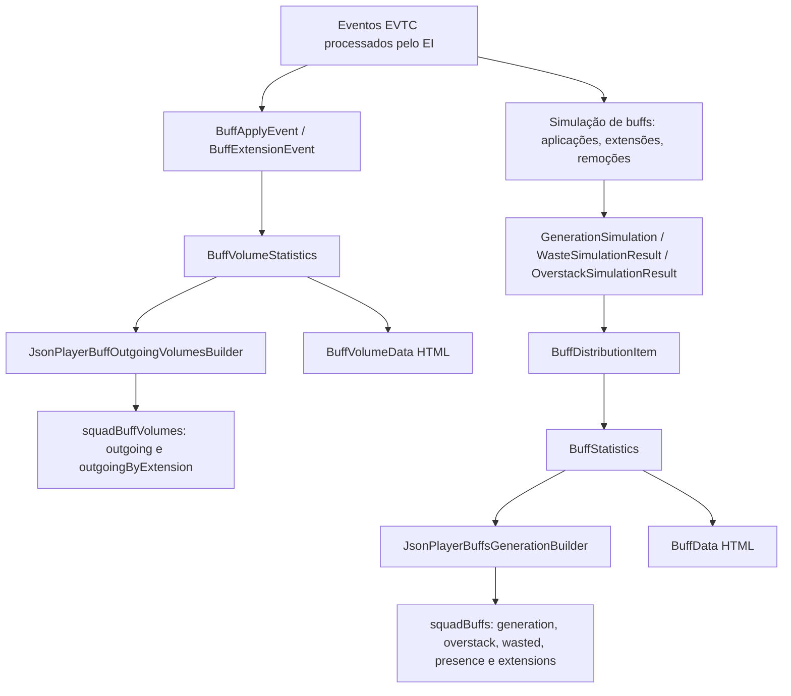

# Auditoria técnica: geração, volume e desperdício de buffs no Elite Insights 3.32

**Destinatário:** Claude Code — manutenção e evolução do site de estatísticas de Guild Wars 2 WvW  
**Escopo:** interpretação dos dados JSON do Elite Insights (EI), cálculo de métricas e requisitos para implementação segura  
**Versão auditada:** `v3.32.0.0`  
**Commit da tag:** `46538a1194c7d9d30ccd36cef93d0a83df09df9e`  
**Repositório:** https://github.com/baaron4/GW2-Elite-Insights-Parser  
**Tag:** https://github.com/baaron4/GW2-Elite-Insights-Parser/tree/v3.32.0.0  
**Commit:** https://github.com/baaron4/GW2-Elite-Insights-Parser/commit/46538a1194c7d9d30ccd36cef93d0a83df09df9e

## 0. Instruções para o Claude Code

Leia este documento integralmente antes de propor alterações. Use as conclusões confirmadas no código do EI como referência semântica, mas verifique como o projeto atual importa, agrega e exibe as estatísticas. Não transforme hipóteses em regras de negócio. Não altere a arquitetura, o banco ou os indicadores públicos sem primeiro identificar os pontos afetados e apresentar um plano de migração. As fórmulas propostas neste documento são métricas derivadas do site, não métricas oficiais do EI.

Classificação da evidência:

- **CONFIRMADO:** observado no código-fonte da tag indicada, inclusive comentários XML e templates HTML oficiais.
- **INFERIDO:** consequência lógica ou hipótese consistente com o código, ainda sem validação empírica no log original.
- **PROPOSTO:** métrica ou decisão de implementação para o site; não faz parte do contrato oficial do EI.
- **NÃO VERIFICADO:** exige investigação adicional.

A análise foi estática. Não houve execução do EI com o EVTC original, inspeção do JSON completo do log de 33 jogadores, auditoria do código do site nem verificação exaustiva do histórico de releases. As observações empíricas abaixo foram fornecidas pelo responsável pelo site.

## 1. Contexto e problema

O site consolida estatísticas de WvW para cada jogador e cada buff, incluindo Stability, Might, Quickness, Alacrity, Protection, Aegis, Resistance, Resolution, Fury, Superspeed e, potencialmente, outros efeitos como Swiftness, Vampiric Aura e Last Rites. Superspeed é tratado aqui como efeito benéfico analisável pelo sistema de buffs, não como boon convencional.

Estruturas relevantes do JSON:

```json
{
  "players": [
    {
      "squadBuffVolumes": [
        {
          "id": 1122,
          "buffVolumeData": [
            { "outgoing": 0.106, "outgoingByExtension": 0 }
          ]
        }
      ],
      "squadBuffs": [
        {
          "id": 1122,
          "buffData": [
            {
              "generation": 0.097,
              "generationPresence": 0,
              "overstack": 0.097,
              "wasted": 0.009,
              "unknownExtended": 0,
              "byExtension": 0,
              "extended": 0
            }
          ]
        }
      ]
    }
  ]
}
```

**Exemplo esquemático, não um recorte do JSON real.** Os valores conhecidos de Stability são `outgoing = 0.106`, `generation = 0.097`, `wasted = 0.009` e, pela observação de igualdade, `overstack = 0.097`. Os demais campos zerados são meramente ilustrativos; não representam valores medidos. Não use esse exemplo como fonte de ID de buff ou de presença em produção: valide IDs no `buffMap` real.

Há equivalentes para Self, Group e Off-Group, além de variantes Active. Os arrays de dados são indexados por fase (não por jogador ou aplicação). O join deve respeitar jogador, ID do buff, fase, escopo e base temporal.

### 1.1 Observação empírica fornecida

- 33 jogadores no log.
- 224 pares jogador/buff comparados entre `squadBuffs` e `squadBuffVolumes`.
- `overstack == generation` nos 224 pares.
- Para os principais boons, `outgoing ≈ generation + wasted`, com diferença mediana igual a zero.
- Stability: `0.106 ≈ 0.097 + 0.009`.
- Exceções observadas: Swiftness (~8% de erro mediano), Vampiric Aura e Last Rites (~4%). A definição exata de erro percentual e as amostras individuais ainda devem ser verificadas no dataset.

Hipótese inicial: outgoing seria o total gerado, generation a parte útil, wasted exclusivamente o excesso de pilhas/duração e a eficiência seria `generation / outgoing`.

**Conclusão da auditoria:** parcialmente correta. `wasted` não é sinônimo de excesso. A igualdade observada não é uma identidade garantida. O aproveitamento temporal não é uma medida direta da qualidade tática.

## 2. Arquitetura interna: duas cadeias de cálculo independentes

**CONFIRMADO.** O parser não calcula outgoing somando os campos de geração. Existem duas cadeias:



O serializador de geração apenas copia os valores (`JsonPlayerBuffsGenerationBuilder.cs`, 11–23):

```csharp
Generation = stats.Generation,
GenerationPresence = stats.GenerationPresence,
Overstack = stats.Overstack,
Wasted = stats.Wasted,
UnknownExtended = stats.UnknownExtended,
Extended = stats.Extended,
ByExtension = stats.ByExtension
```

O serializador de volume também só copia os campos (`JsonPlayerBuffOutgoingVolumes.cs`, builder, 11–19):

```csharp
Outgoing = stats.Outgoing,
OutgoingByExtension = stats.OutgoingByExtension
```

Em `SingleActorBuffsHelper.cs`, 348–366, a distribuição é preenchida separadamente por itens de geração, waste e overstack. Em `BuffDistribution.cs`, 106–139, os getters leem os acumuladores independentes de `BuffDistributionItem`.

Referências: [S1–S5], [S8].

## 3. Pergunta 1 — Semântica de cada campo e unidade de medida

### 3.1 Dicionário de dados

**CONFIRMADO**, a partir dos modelos JSON, da simulação, dos getters de distribuição e do template HTML.

| Campo | Definição | Relação com outros campos |
|---|---|---|
| `generation` | Duração efetivamente ativa atribuída à fonte, incluindo a parcela ativa de extensões que ela gerou. Para intensidade, ponderada pelo número de pilhas. | Inclui `byExtension`. Não significa necessariamente benefício tático. |
| `generationPresence` | Percentual médio do tempo em que ao menos uma pilha ativa atribuída à fonte esteve presente nos destinatários. | Relevante para intensidade; zero para duração segundo o modelo oficial. Não é a mesma coisa que uptime total do destinatário. |
| `overstack` | Geração efetiva somada à duração de aplicações explicitamente rejeitadas pelo simulador. | Já inclui `generation`; não é o excesso isolado. |
| `wasted` | Duração restante contabilizada como perdida em remoções/substituições de pilhas e extensões. | Não é sinônimo de overstack ou falha individual. |
| `unknownExtended` | Duração efetiva de extensão de um buff cuja fonte original (seed) é o jogador, mas cuja fonte da extensão é desconhecida. | Não é geração creditada ao seed. É parcela de `extended` conforme a semântica do HTML. |
| `byExtension` | Duração efetiva gerada pelo jogador por meio da extensão de buffs. | Já incluída em `generation`. |
| `extended` | Duração efetiva pela qual o buff originalmente gerado pelo jogador foi estendido por outra fonte, conhecida ou desconhecida. | Crédito de seed; não adicionar à geração efetiva do seed. |
| `outgoing` | Soma normalizada das durações registradas de aplicações e extensões atribuídas à fonte. | Inclui `outgoingByExtension`; não é soma de campos da simulação. |
| `outgoingByExtension` | Parcela de volume de saída oriunda de extensões. | Já incluída em `outgoing`. |

A geração por extensão é creditada à fonte da extensão. `BuffSimulationItemBaseWithExtension.cs` chama o método base, que incrementa o valor de geração (`weight * cDur`), e acrescenta esse valor ao acumulador de extensão. `BuffSimulationItemBaseWithSeed.cs` credita a extensão ao seed em `Extended` e, quando `Src.IsUnknown`, também em `UnknownExtension`.

Em `BuffSimulationItemDuration.cs`, 81–88, a geração é atribuída à pilha ativa, com peso 1. Em `BuffSimulationItemIntensity.cs`, 121–130, cada conjunto de pilhas é ponderado por `StackCount`. A presença usa os intervalos nos quais há pelo menos uma pilha ativa atribuída à fonte (`BuffSimulationItem.cs`, 30–40; `SingleActorBuffsHelper.cs`, 381–427).

### 3.2 Fórmulas de normalização — fase inteira

Definições:

- `T`: duração da fase, em ms (`end - start`).
- `N`: número de destinatários do escopo considerados elegíveis (`InAwareTimes(start, end)`).
- `G`: soma das durações efetivas atribuídas à fonte, acumuladas nos destinatários (ms para duração, pilha·ms para intensidade).
- `R`: duração interna de aplicações rejeitadas, antes da normalização.
- `W`: duração interna desperdiçada, antes da normalização.
- `P`: soma de duração de presença de pelo menos uma pilha atribuída à fonte.
- `k`: 100 para buffs de duração, 1 para intensidade.
- `round3`: arredondamento para três casas decimais (`ParserHelper.BuffDigit = 3`).

```text
generation          = round3(k * G / (T * N))
overstack           = round3(k * (G + R) / (T * N))
wasted              = round3(k * W / (T * N))
generationPresence  = round3(100 * P / (T * N))  [somente intensidade]
```

As demais métricas de extensão seguem a mesma normalização com `k`, usando seus próprios acumuladores.

Para Self, o cálculo não divide pelo número de outros jogadores. Use o escopo correspondente; não some médias de Group e Off-Group sem reconstruir os denominadores.

### 3.3 Tipos de buff

| Buff | Tipo esperado | Unidade dos campos de geração/volume |
|---|---|---|
| Stability | Intensidade | Pilhas médias / pilha-tempo normalizado |
| Might | Intensidade | Pilhas médias / pilha-tempo normalizado |
| Quickness | Duração | Percentual de tempo normalizado |
| Alacrity | Duração | Percentual de tempo normalizado |
| Protection | Duração | Percentual de tempo normalizado |
| Aegis | Duração | Percentual de tempo normalizado |
| Resistance | Duração | Percentual de tempo normalizado |
| Resolution | Duração | Percentual de tempo normalizado |
| Fury | Duração | Percentual de tempo normalizado |
| Swiftness | Duração | Percentual de tempo normalizado |
| Superspeed | Duração | Percentual de tempo normalizado |

A distinção de cálculo por `BuffType` está confirmada; a lista acima é a classificação esperada para os buffs citados. **Em produção, resolver a classificação pela metadata do EI (`buffMap` / stacking) e pelo ID, em vez de fixar o comportamento exclusivamente pelo nome.** A auditoria não inspecionou o cadastro individual de cada buff nem todas as mudanças de regras entre builds do jogo.

Exemplos:

- Quickness `generation = 12.5` significa 12,5% de geração média, não 1.250%.
- Might `generation = 2.5` significa 2,5 pilhas médias.
- Stability `generation = 0.097` significa 0,097 pilha média, não 9,7% de uptime.
- Stability `generationPresence = 8` significa presença em 8% do tempo, em média.
- Três pilhas durante cinco segundos, em uma fase de dez segundos sobre um destinatário: geração = `(3 × 5) / 10 = 1.5`; presença = `100 × 5 / 10 = 50%`.

Para volume, os valores têm escala semelhante, mas não são cobertura efetiva: representam as durações nominais registradas por unidade de tempo e destinatário. Um volume de duração pode ultrapassar 100% devido a aplicações sobrepostas ou longas.

### 3.4 Escopo e tempo ativo

**CONFIRMADO quanto à lógica.** Existem variantes de fase inteira e tempo ativo. Os nomes usados na discussão são `squadBuffs` / `squadBuffsActive`, `squadBuffVolumes` / `squadBuffVolumesActive`, `groupBuffs` / `groupBuffsActive`, `groupBuffVolumes` / `groupBuffVolumesActive`; conferir os nomes e disponibilidade na versão realmente importada pelo site.

- Self: fonte sobre si mesma.
- Group: membros do próprio grupo, excluindo a fonte.
- Off-Group: membros de outros grupos, excluindo a fonte.
- Squad: membros do squad, excluindo a fonte.

Em 33 jogadores elegíveis incluindo a fonte, o denominador de Squad pode ser 32. Não usar sempre `players.length - 1`: a elegibilidade e a composição do escopo precisam ser confirmadas.

Nas variantes Active, a normalização acontece primeiro por duração ativa do destinatário, não da fonte. **Detalhe relevante:** em `BuffStatistics.GetBuffsForPlayers`, `activePlayerCount` é incrementado dentro do bloco `HasBuffID`, se `playerActiveDuration > 0` (linhas 64–96). Já em `BuffVolumeStatistics.GetBuffVolumesForPlayers`, ele é incrementado para os destinatários ativos antes do loop de eventos (linhas 41–48). Assim, mesmo comparando dois arrays Active, os denominadores podem diferir. Não presumir equivalência automática entre volume e geração Active.

**Não dividir novamente generation ou outgoing pelo tempo ou por minutos.** Já são valores normalizados. Se for necessária uma medida absoluta, reconstruir apenas com os denominadores corretos e aceitar a perda de precisão do arredondamento; a melhor fonte para totais absolutos são os acumuladores/eventos originais.

Referências: [S1–S10], [S15–S17], [S21].

## 4. Pergunta 2 — Outgoing é igual a generation + wasted?

**CONFIRMADO: não é uma identidade implementada pelo EI.**

Em `BuffVolumeStatistics.cs`, 48–74, são percorridos os eventos de aplicação/extensão do destinatário, filtrados pela fonte e pelo buff:

```csharp
// Trecho reduzido, sem as operações Active.
foreach (BuffEvent abae in p.GetBuffApplyEventsOnByID(
    log, start, end, buff.ID, srcActor))
{
    if (abae is BuffApplyEvent bae)
        totalOutgoing += bae.AppliedDuration;

    if (abae is BuffExtensionEvent bee)
        totalOutgoingByExtension += bee.ExtendedDuration;
}
totalOutgoing += totalOutgoingByExtension;
```

O código divide pela duração da fase, pelo número de destinatários, multiplica por 100 se o buff for de duração e arredonda.

```text
outgoing = round3(k * (sum(AppliedDuration) + sum(ExtendedDuration)) / (T * N))
outgoingByExtension = round3(k * sum(ExtendedDuration) / (T * N))
```

`BuffApplyEvent.AppliedDuration` vem de `evtcItem.Value`; não é um cálculo teórico do potencial da habilidade. `BuffExtensionEvent.ExtendedDuration` parte do valor do evento e pode ser corrigido pelo processamento do EI conforme a versão do arcdps. Aplicações que não foram registradas no log não podem ser recuperadas automaticamente por esta fórmula.

**INFERIDO:** em circunstâncias nas quais os dois caminhos contam os mesmos eventos e as perdas estão integralmente contabilizadas, espera-se aproximadamente:

```text
outgoing ≈ generation + explicitRejected + wasted
explicitRejected ≈ overstack - generation
outgoing ≈ overstack + wasted
```

Quando `overstack == generation`, a relação se reduz a `outgoing ≈ generation + wasted`, como nos 224 registros analisados pelo responsável pelo projeto. Não tratar como regra universal nem preencher campos ausentes a partir dessa aproximação.

### 4.1 Motivos para divergências

| Motivo | Consequência possível |
|---|---|
| Aplicação perto do fim da fase | O volume registra a duração do evento; a geração conta somente a parte ativa dentro da fase. |
| Aplicação antes do começo da fase | Geração pode ser registrada sem aplicação correspondente dentro da fase. |
| Buff ainda ativo ao final do log | O restante pode ficar fora da geração e do desperdício. |
| Extensão com fonte desconhecida | Diferenças na atribuição do crédito. |
| Desaparecimento de uma entidade | Limpeza de pilhas pode não gerar waste. |
| Simulador com ou sem ID | Caminhos diferentes de rejeição e remoção. |
| Arredondamento | Cada campo é arredondado independentemente. |
| Variantes Active | Denominadores potencialmente diferentes. |
| Eventos de duração muito longa | O filtro de duração infinita aparece comentado no cálculo de volume da tag; não confiar apenas no tooltip que afirma ignorá-los. |

A simulação limita os intervalos pela janela analisada (`BuffSimulationItem.GetClampedDuration`) e pelo final do log (`AbstractBuffSimulator.Trim`). Já as perdas são atribuídas por timestamp do evento, conforme `SimulationItemWasted.GetValue` (17–20).

Não foi identificada a causa específica dos desvios de Swiftness, Vampiric Aura e Last Rites. É necessário inspecionar as aplicações, extensões, estados iniciais, remoções e fronteiras da fase no EVTC original. As diferenças estruturais acima são hipóteses de investigação, não diagnósticos confirmados para esses buffs.

### 4.2 Exemplo real fornecido: Stability

```text
outgoing       = 0.106
generation     = 0.097
overstack      = 0.097
wasted         = 0.009

utilização do volume = 0.097 / 0.106 = 91.5094%
perda registrada    = 0.009 / 0.106 =  8.4906%
rejeição explícita   = 0.097 - 0.097 = 0
resíduo              = 0.106 - (0.097 + 0.009) ≈ 0
```

Os 8,49% são perdas de duração contabilizadas, não prova de aplicação excessiva. Os percentuais calculados a partir de campos arredondados são estimativas.

Referências: [S3], [S6], [S7], [S8], [S11–S14], [S20].

## 5. Pergunta 3 — O que entra em wasted?

**CONFIRMADO:** `wasted` inclui remoções e substituições. Não se limita a rejeições por excesso.

Em `BuffSimulatorID.cs`, método `Remove`, linhas 36–121, ambos os caminhos comentados como `Removed due to override` e `Removed due to a cleanse` alimentam `WasteSimulationResult`. A duração restante da pilha e das suas extensões é creditada às respectivas fontes:

```csharp
WasteSimulationResult.Add(
    new BuffSimulationItemWasted(toRemove.Src, toRemove.Duration, time));
```

Remoções individuais passam por uma tolerância: `removedDuration > ParserHelper.BuffSimulatorDelayConstant` (15 ms). O caminho de remoção total por desaparecimento (`FullRemoval`) limpa as pilhas sem adicionar waste. No simulador sem ID, remoções também podem alimentar waste; o algoritmo de fila pode registrar como waste a pilha substituída (`QueueLogic.cs`, 12–31).

| Evento | Interpretação |
|---|---|
| Pilha substituída/override | Pode ser contabilizada como waste. |
| Strip inimigo | Pode ser contabilizado como waste, conforme evento de remoção. |
| Corrupção de boon | Pode contabilizar a remoção do boon original como waste; a auditoria não rastreou a classificação específica de todas as habilidades. |
| Condition cleanse | Pode alimentar waste para condições. |
| Expiração natural | Duração já consumida não é duração restante desperdiçada. |
| Aplicação rejeitada no caminho NoID | Alimenta o overstack interno separado. |
| Final do log | Não garante contabilização da duração remanescente em waste. |
| Desaparecimento de entidade | Há caminho de limpeza sem contabilizar waste. |

**INFERÊNCIA TÁTICA:** Stability consumida ao impedir controle de grupo e Aegis consumida ao bloquear um ataque podem cumprir sua finalidade sem permanecer ativas durante toda a duração nominal. O enquadramento como waste depende dos eventos e da simulação; o agregado não distingue finalidade tática. Um jogador que sofreu strips inimigos e outro que renovou buffs cedo demais podem apresentar a mesma razão geração/volume.

Não nomear `wasted` como “overstack”, “boons inúteis”, “erros do jogador” ou “cast desperdiçado”. Preferir **Recorded Waste / Perda registrada**.

Referências: [S11], [S12], [S13], [S15], [S20].

## 6. Pergunta 4 — Por que overstack é igual a generation?

**CONFIRMADO quanto ao mecanismo; INFERIDO quanto ao caminho usado pelo log específico.**

### 6.1 A fórmula inclui a geração

`BuffStatistics.cs`, linhas 116–118 (duração) e 135–138 (intensidade):

```csharp
uptime.Generation = Math.Round(100.0 * totalGeneration / playerCount, ParserHelper.BuffDigit);
uptime.Overstack = Math.Round(100.0 * (totalOverstack + totalGeneration) / playerCount, ParserHelper.BuffDigit);
uptime.Wasted = Math.Round(100.0 * totalWasted / playerCount, ParserHelper.BuffDigit);
```

Para intensidade, a mesma estrutura sem o fator 100. Portanto:

```text
exportedOverstack = generation + normalisedInternalOverstack  [antes de arredondamento]
explicitRejected ≈ exportedOverstack - generation
```

O campo `overstack` não é duplicado pelo serializador nem representa exclusivamente o excesso.

### 6.2 Dois simuladores

`Buff.cs`, 196–225, escolhe o simulador por tipo de buff e disponibilidade de identificadores de instância (`UseBuffInstanceSimulator` / `forceNoId`).

- **NoID:** `BuffSimulatorNoID/BuffSimulator.cs`, 65–70, registra rejeições em `OverstackSimulationResult` quando a lógica de empilhamento não encontra uma pilha para substituir.
- **ID:** `BuffSimulatorID.cs`, `BuffSimulatorIDDuration.cs` e `BuffSimulatorIDIntensity.cs` não adicionam itens a `OverstackSimulationResult` nos caminhos analisados. Aplicações entram nas estruturas de instância; perdas relevantes de remoção e substituição vão para `WasteSimulationResult`.
- `SingleActorBuffsHelper.cs`, 994–1015, mostra que alguns atores usam o caminho NoID e que uma falha de simulação com ID pode acionar fallback para NoID. A escolha pode variar dentro de um mesmo log.

Se a lista de overstack interno está vazia, `overstack == generation` por construção. Também pode haver igualdade por ausência de rejeições ou arredondamento. Logo, os 224 pares iguais não comprovam ausência de excesso nem permitem, por si só, identificar o simulador usado. A hipótese predominante é uso do caminho com ID; confirmar com logs de diagnóstico ou instrumentação.

### 6.3 Histórico

**CONFIRMADO:** a comparação pontual com a tag `v3.30.2.0` revelou a mesma fórmula de Overstack e a mesma contabilização de remoções como Waste no simulador ID. Portanto, não é novidade introduzida em 3.32.

**NÃO VERIFICADO:** primeira versão/commit que introduziu o comportamento, existência de issue pública específica e se a branch principal mudou após a versão auditada. Não classificar o comportamento como bug conhecido sem localizar evidência histórica.

Referências: [S3], [S8], [S11–S14], [S18], [S24–S25].

## 7. Pergunta 5 — Métricas adequadas para o site

**PROPOSTO.** As seguintes métricas não são indicadores oficiais do EI. Usar os mesmos escopo, fase, tipo e base temporal de dados. Para divisão por zero ou dados insuficientes, retornar `null` (N/D).

| Nome | Fórmula (percentual quando aplicável) | Interpretação |
|---|---|---|
| Outgoing Volume | `outgoing` | Volume de aplicações/extensões registrado e normalizado. |
| Effective Generation | `generation` | Geração ativa atribuída à fonte. |
| Generation Presence | `generationPresence` | Cobertura média de presença atribuída à fonte, somente intensidade. |
| Recorded Waste | `wasted` | Duração restante perdida contabilizada. |
| Explicit Rejection | `overstack - generation` | Rejeição explicitamente registrada, sujeita a arredondamento e limitações do simulador. |
| Volume Utilization (BVU) | `100 * generation / outgoing` | Comparação de geração efetiva com o volume registrado. Pode ultrapassar 100% devido aos diferentes caminhos de cálculo. |
| Generation Utilization (BGU) | `100 * generation / (generation + wasted)` | Aproveitamento dentro de duas categorias da simulação; exclui rejeições explícitas. |
| Accounted Utilization (ABU) | `100 * generation / (overstack + wasted)` | Aproveitamento dentro da geração, rejeições e desperdícios contabilizados. Não representa todo o potencial de aplicação. |
| Recorded Waste Rate (BWR) | `100 * wasted / (overstack + wasted)` | Proporção de perda registrada nas categorias contabilizadas. |
| Explicit Rejection Rate (BRR) | `100 * (overstack - generation) / (overstack + wasted)` | Proporção de rejeições explícitas; zero não é prova de ausência de excesso. |
| Volume Residual | `outgoing - (overstack + wasted)` | Divergência entre caminhos de cálculo, para auditoria. |

**Recomendação:** usar Accounted Utilization como indicador principal de aproveitamento contabilizado e Volume Utilization como indicador complementar, preferencialmente em dados de fase inteira (não Active) até validar as diferenças de denominadores. Manter geração e volume brutos ao lado dos percentuais. Não ordenar qualidade tática exclusivamente por esses índices.

Quando `overstack == generation`, ABU e BGU são equivalentes. Para dados válidos, ABU + BWR + BRR ≈ 100%; isso decorre da construção da fórmula e não comprova que todas as perdas do jogo foram capturadas.

Um jogador que gerou muito pouco pode ter utilização de 100%. O indicador de aproveitamento deve ser exibido junto ao volume/geração, quantidade de logs e outras medidas de contribuição. Não comparar diretamente unidades de buffs de duração e intensidade, nem somar valores normalizados heterogêneos.

### 7.1 Como avaliar aplicação concentrada de habilidades

**INFERIDO:** totais agregados não contêm informação temporal suficiente para determinar se as habilidades foram disparadas juntas ou espaçadas.

**PROPOSTO:** adicionar, quando houver dados, uma camada separada de análise tática:

| Métrica | Dados necessários | Objetivo |
|---|---|---|
| Boon Burst Concentration | Eventos de aplicação com timestamp e duração | Medir proporção de volume concentrada em janela móvel. |
| Application Interval | Casts ou aplicações identificadas por habilidade | Medir espaçamento entre usos. Deduplicar aplicações da mesma habilidade em vários alvos. |
| Boon Coverage Gaps | Séries de estado do buff por destinatário | Medir períodos descobertos. |
| Cap Application Rate | Estado das pilhas/duração imediatamente antes da aplicação | Medir aplicações perto do limite, conforme regras e build do jogo. |
| Enemy Strip Loss | Eventos de remoção, fonte inimiga, pilha e duração remanescente | Separar perdas por ação inimiga. |
| Override Loss | Eventos de substituição e estado das pilhas | Separar perdas por substituição. |
| Critical Window Coverage | Estados do buff e janelas relevantes (engage, pressão, disengage etc.) | Avaliar disponibilidade quando necessária. |

Fórmula experimental de concentração (não oficial):

```text
BurstConcentration(w) = max(volume aplicado em uma janela móvel de duração w)
                        / volume total aplicado na fase
```

Testar janelas de 3 e 5 segundos como parâmetros iniciais, não como padrões validados. Distinguir concentração de eventos por destinatário e concentração de casts; uma habilidade pode atingir vários jogadores ao mesmo tempo. Uma janela de engage pode exigir precisamente a aplicação concentrada de Stability. Não punir concentração sem contexto tático.

### 7.2 Comunidade e plataformas externas

**NÃO VERIFICADO:** não foi possível auditar a fórmula interna de wvw.bel.st ou GW2 Mists. Não há evidência suficiente nesta auditoria de que `generation / outgoing` seja uma métrica padronizada pela comunidade. Snow Crows e projetos públicos de agregação WvW são referências complementares para investigação, não comprovação das fórmulas propostas. O EI confirma oficialmente geração, presença, volume e perdas por meio dos próprios templates HTML.

## 8. Pergunta 6 — Correspondência com o relatório HTML

**CONFIRMADO NOS TEMPLATES DA TAG 3.32.0.0.**

### 8.1 Painel Buffs / Generation

`tmplBuffStats.html`, 9–24, define as abas `Generation Self`, `Generation Group`, `Generation Off-Group`, `Generation Squad`; as três últimas excluem a fonte. A aba de uptime corresponde a outra visão de dados, não à geração individual.

| Aba | Família JSON correspondente |
|---|---|
| Generation Self | `selfBuffs` |
| Generation Group | `groupBuffs` |
| Generation Off-Group | `offGroupBuffs` |
| Generation Squad | `squadBuffs` |

`BuffData.cs`, 75–84:

```csharp
[
    uptime.Generation,
    uptime.Overstack,
    uptime.Wasted,
    uptime.UnknownExtended,
    uptime.ByExtension,
    uptime.Extended,
    uptime.GenerationPresence
]
```

| Valor / texto exibido no HTML | Campo JSON | Índice |
|---|---|---:|
| Valor principal de cada célula de buff | `generation` | 0 |
| with overstack | `overstack` | 1 |
| wasted | `wasted` | 2 |
| extended by unknown source | `unknownExtended` | 3 |
| by extension | `byExtension` | 4 |
| extended | `extended` | 5 |
| generated as presence | `generationPresence` | 6 |

Os campos auxiliares aparecem no tooltip da célula, não necessariamente em colunas próprias. Em `tmplBuffTable.html`, 131–134, o tooltip só mostra `with overstack` quando `val[1] !== val[0]`. Os demais detalhes são exibidos quando positivos. A célula principal usa `val[0]`.

O texto de ajuda do template (184–193) distingue: geração efetiva incluindo extensões da fonte; rejeições de empilhamento adicionadas à geração; waste por substituição ou remoção; extensão e seed. Também define presença como tempo com pelo menos uma pilha ativa gerada pela fonte.

### 8.2 Painel Buff Volumes / Outgoing

`tmplBuffVolumeStats.html`, 9–24, define as abas:

| Aba | Família JSON correspondente |
|---|---|
| Outgoing Self | `selfBuffVolumes` |
| Outgoing Group | `groupBuffVolumes` |
| Outgoing Off-Group | `offGroupBuffVolumes` |
| Outgoing Squad | `squadBuffVolumes` |

`BuffVolumeData.cs`, 61–65:

```csharp
[ volume.Outgoing, volume.OutgoingByExtension ]
```

O valor principal é `outgoing`; o tooltip mostra `outgoingByExtension` quando positivo. O HTML confirma que as extensões da fonte estão incluídas no volume total.

Não foi encontrada nesses templates uma coluna oficial de eficiência `generation / outgoing`. Não confundir os valores da aba Generation Squad com os valores de Outgoing Squad.

Referências: [S19–S23].

## 9. Exemplo de implementação TypeScript

**PROPOSTO, não é código do EI nem patch já validado no site.** Adaptar aos tipos, regras de ingestão e persistência existentes. A função deliberadamente não substitui campos ausentes por zero e não limita silenciosamente índices acima de 100%. Validar disponibilidade e correspondência dos registros antes de chamá-la.

```typescript
interface BuffGenerationData {
  generation: number;
  generationPresence: number;
  overstack: number;
  wasted: number;
  unknownExtended: number;
  byExtension: number;
  extended: number;
}

interface BuffVolumeData {
  outgoing: number;
  outgoingByExtension: number;
}

function calculateBoonMetrics(
  buff: BuffGenerationData,
  volume: BuffVolumeData,
) {
  const { generation: g, wasted: w, overstack: s } = buff;
  const { outgoing: o } = volume;
  const values = [g, w, s, o, buff.generationPresence,
    buff.unknownExtended, buff.byExtension, buff.extended,
    volume.outgoingByExtension];

  if (!values.every(v => Number.isFinite(v) && v >= 0)) {
    throw new Error('Missing or invalid EI buff statistics');
  }
  if (s < g) {
    throw new Error('Inconsistent EI statistics: overstack < generation');
  }

  const rejected = s - g;
  const accounted = s + w;
  const ratio = (a: number, b: number): number | null =>
    b > 0 ? (a / b) * 100 : null;

  return {
    effectiveGeneration: g,
    outgoingVolume: o,
    generationPresence: buff.generationPresence,
    recordedWaste: w,
    explicitRejected: rejected,
    volumeUtilization: ratio(g, o),
    generationUtilization: ratio(g, g + w),
    accountedUtilization: ratio(g, accounted),
    wasteRate: ratio(w, accounted),
    rejectionRate: ratio(rejected, accounted),
    volumeResidual: o - accounted,
    outgoingByExtension: volume.outgoingByExtension,
    effectiveByExtension: buff.byExtension,
    extended: buff.extended,
    unknownExtended: buff.unknownExtended,
    flags: {
      generationExceedsOutgoing: g > o,
      explicitRejectionNotObserved: s === g,
    },
  };
}
```

Em um pipeline de produção, uma entrada inválida deve ser marcada/quarentenada com motivo e contexto (log, player, buff, fase, versão), sem necessariamente derrubar todo o processamento. A função ilustra validação estrita; adaptar a estratégia de erros. `generationPresence` deve ser apresentado como N/D para duração, ainda que o JSON exporte zero. Se o parser omitir valores padrão na serialização, distinguir ausência semanticamente equivalente a zero (confirmada no contrato da versão) de ausência desconhecida antes de normalizar a entrada.

### 9.1 Agregação entre múltiplos logs

Não fazer média simples dos percentuais por jogador, buff ou log sem definir o estimando. Exemplo: dois logs de mesmo denominador de normalização, um com volume 1 e geração 1, outro com volume 9 e geração 3, produzem taxas de 100% e 33,33%; a razão dos totais é 40%, não a média simples de 66,67%.

Para combinar estatísticas de fase inteira, se `T_i` e `N_i` forem conhecidos e os escopos compatíveis, reconstruir aproximadamente os acumuladores (`normalized_i * T_i * N_i / k`) antes de agregar. Para variantes Active, o agregado por destinatário pode não ser invertível com um único denominador; preferir dados originais por destinatário/evento. Não agregar unidades distintas de boons sem uma metodologia explicitamente definida.

## 10. Requisitos e validações para implementação

### Etapa A — Auditar o site antes de editar

1. Identificar ingestão de JSON, versão do EI, escopos de buff e fase selecionada; localizar todos os consumidores no backend, frontend, banco, APIs, relatórios e ranking.
2. Mapear nomes atuais de métricas, unidades e regras de normalização. Procurar `outgoing`, `generation`, `wasted`, `overstack`, `generationPresence`, `buffVolumeData`, `squadBuffVolumes`, `squadBuffs`, divisões por duração/tempo ativo e multiplicações por 100.
3. Verificar se os tipos de buff vêm do `buffMap` ou de classificação própria. Validar como Superspeed e auras são incluídos.
4. Identificar se o sistema agrega por destinatário, grupo, squad, log, sessão ou jogador; localizar qualquer média simples de razões e qualquer mistura Active/fase inteira.
5. Entregar diagnóstico de impacto, hipóteses e plano de correção antes de mudanças amplas.

### Etapa B — Modelar e calcular

1. Preservar valores originais do EI sem modificar semanticamente os campos.
2. Separar nomes oficiais e derivados do site; registrar versão da fórmula para permitir comparação histórica.
3. Calcular indicadores com denominadores válidos; retornar N/D se ausentes/zero; não forçar taxa para intervalo [0,100].
4. Calcular e armazenar residual para auditoria; não corrigir os dados à força impondo igualdade entre volume e geração contabilizada.
5. Não somar `byExtension` à geração nem `outgoingByExtension` ao volume, pois já são incluídos. Não creditar `extended` ou `unknownExtended` novamente ao seed como geração.
6. Exibir unidades compatíveis com duração/intensidade e distinguir percentual de presença de pilhas médias.
7. Se `overstack == generation`, indicar apenas que não houve rejeição explícita observada. Não inferir que a taxa de excesso real é zero.

### Etapa C — Testes de regressão

| Cenário sintético | Entrada principal `(g,o,s,w)` | Resultado esperado |
|---|---|---|
| Stability fornecida | `(0.097, 0.106, 0.097, 0.009)` | BVU, BGU e ABU ≈ 91,51%; BWR ≈ 8,49%; rejeição 0; residual ≈ 0. |
| Rejeições explícitas | `(6, 10, 8, 2)` | BVU e ABU 60%; BGU 75%; BWR 20%; BRR 20%; residual 0. |
| Volume excede contabilizado | `(6, 12, 8, 2)` | BVU 50%; ABU 60%; residual 2; não reclassificar residual como waste. |
| Geração excede volume | `(6, 4, 6, 0)` | BVU 150%; flag; ABU 100%; residual -2. |
| Tudo zero | `(0, 0, 0, 0)` | Razões N/D; não exibir eficiência 0% ou 100%. |
| Volume ausente | `outgoing` ausente | N/D para métricas dependentes de volume; não inventar zero. |
| Geração com `overstack < generation` | `(6, 10, 5, 2)` | Inconsistência identificada, não mascarada. |
| Extensões | `byExtension > 0` | Não adicionar a `generation` novamente; mesmo princípio para outgoing. |
| Buff de duração | Quickness `generation=12.5` | Exibir 12,5%, não multiplicar por 100 novamente. |
| Buff de intensidade | Stability `generation=0.097` | Exibir pilhas médias, não 9,7% de uptime. |
| Active vs normal | Dois registros com base temporal diferente | Rejeitar join/combinação inadequados. |
| Escopos diferentes | Self/Group/Off-Group/Squad | Não misturar denominadores ou somar médias sem ponderação. |
| Fase diferente / ID diferente | Registros incompatíveis | Rejeitar join incorreto. |
| Divergência pequena | Campos arredondados a 3 casas | Considerar tolerância de ponto flutuante; não exigir igualdade exata. |

Os números acima são casos de teste para a função proposta, não fixtures extraídas de logs reais. Para o caso de ausência, o pipeline deve decidir se apresenta os demais indicadores disponíveis ou rejeita o registro; não presumir que a função estrita resolve ingestão parcial.

### Etapa D — Validação com dados reais

1. Reproduzir os 224 pares do log original e guardar `generation`, `overstack`, `wasted`, `outgoing`, extensões, presença, duração, destinatários elegíveis, versão e fase.
2. Comparar distribuições de `outgoing - (overstack + wasted)` e `overstack - generation`; calcular resíduo absoluto e relativo com definição explícita de denominador e tratar volume zero.
3. Investigar os desvios de Swiftness, Vampiric Aura e Last Rites; comparar aplicação inicial/final, extensão, duração, remoção e caminho do simulador.
4. Confirmar os indicadores comparando as células e tooltips do HTML oficial do mesmo log e da mesma configuração de tempo ativo.
5. Se possível, instrumentar uma execução local do EI para observar uso do simulador ID/NoID e fallback, bem como os acumuladores antes do arredondamento.
6. Validar em diferentes composições, durações, classes, builds do arcdps/EI e níveis de pressão inimiga. Separar perdas registradas de julgamento tático.
7. Somente depois de validar, ajustar a interface e recalcular dados históricos com versionamento da fórmula, se necessário.

### Etapa E — Interface sugerida

Exibir, para Stability do exemplo fornecido:

| Indicador | Valor |
|---|---:|
| Outgoing Volume | 0.106 |
| Effective Generation | 0.097 pilha média |
| Accounted Utilization | 91,51% |
| Recorded Waste | 0.009 |
| Recorded Waste Rate | 8,49% |
| Explicit Rejection | 0.000 (não observado) |
| Generation Presence | N/D no exemplo, pois não foi fornecida |
| Burst Concentration | N/D até que os dados temporais estejam disponíveis |

Tooltip sugerido para aproveitamento: “Proporção da geração efetiva em relação à geração, rejeições e perdas registradas pelo Elite Insights. Inclui perdas por remoção/substituição; não é uma medida isolada de qualidade tática.”

### Etapa F — Extensão futura de análise tática

Antes de implementar concentração temporal ou classificação de strip/override, identificar quais dados granulares existem no JSON atualmente exportado, se há dados de casts/estados por fonte e se é necessário acessar EVTC, instrumentar o parser ou habilitar outra opção de exportação. Não presumir que o JSON agregado possua todos os eventos necessários. Propor extensão de ingestão apenas após provar a disponibilidade e qualidade dos dados.

## 11. Fontes primárias versionadas

Todos os links [S1–S23] abaixo apontam para a tag `v3.32.0.0` auditada. As linhas são as identificadas no conteúdo recuperado dos arquivos. [S24–S25] são comparação pontual com `v3.30.2.0`.

- **[S1]** [JsonPlayerBuffsGeneration.cs — modelo e comentários XML](https://github.com/baaron4/GW2-Elite-Insights-Parser/blob/v3.32.0.0/GW2EI.Library/GW2EI.Models/GW2EIJSON/JsonActorUtilities/JsonPlayerUtilities/JsonPlayerBuffsGeneration.cs#L11-L60)
- **[S2]** [JsonPlayerBuffsGenerationBuilder.cs — serialização](https://github.com/baaron4/GW2-Elite-Insights-Parser/blob/v3.32.0.0/GW2EI.Library/GW2EI.Services/GW2EIBuilders/JsonModels/JsonActorUtilities/JsonPlayerUtilities/JsonPlayerBuffsGenerationBuilder.cs#L11-L23)
- **[S3]** [BuffStatistics.cs — geração, presença, overstack, waste, normalização](https://github.com/baaron4/GW2-Elite-Insights-Parser/blob/v3.32.0.0/GW2EI.Library/GW2EI.Services/GW2EIEvtcParser/EIData/Statistics/BuffStatistics.cs#L18-L250)
- **[S4]** [BuffDistribution.cs — acumuladores e getters](https://github.com/baaron4/GW2-Elite-Insights-Parser/blob/v3.32.0.0/GW2EI.Library/GW2EI.Services/GW2EIEvtcParser/EIData/Buffs/BuffDistribution.cs#L6-L139)
- **[S5]** [JsonPlayerBuffOutgoingVolumes.cs — modelo e extensões incluídas](https://github.com/baaron4/GW2-Elite-Insights-Parser/blob/v3.32.0.0/GW2EI.Library/GW2EI.Models/GW2EIJSON/JsonActorUtilities/JsonPlayerUtilities/JsonPlayerBuffOutgoingVolumes.cs#L11-L36)
- **[S6]** [BuffVolumeStatistics.cs — cálculo de volume e normalização](https://github.com/baaron4/GW2-Elite-Insights-Parser/blob/v3.32.0.0/GW2EI.Library/GW2EI.Services/GW2EIEvtcParser/EIData/Statistics/BuffVolumeStatistics.cs#L15-L219)
- **[S7]** [JsonPlayerBuffOutgoingVolumes.cs — builder do volume](https://github.com/baaron4/GW2-Elite-Insights-Parser/blob/v3.32.0.0/GW2EI.Library/GW2EI.Services/GW2EIBuilders/JsonModels/JsonActorUtilities/JsonPlayerUtilities/JsonPlayerBuffOutgoingVolumes.cs#L11-L19)
- **[S8]** [SingleActorBuffsHelper.cs — distribuição, presença e fallback de simulador](https://github.com/baaron4/GW2-Elite-Insights-Parser/blob/v3.32.0.0/GW2EI.Library/GW2EI.Services/GW2EIEvtcParser/EIData/Actors/ActorsHelper/SingleActorBuffsHelper.cs)
- **[S9]** [BuffSimulationItemBase.cs — peso × duração](https://github.com/baaron4/GW2-Elite-Insights-Parser/blob/v3.32.0.0/GW2EI.Library/GW2EI.Services/GW2EIEvtcParser/EIData/Buffs/BuffSimulators/BuffSimulationItems/Base/BuffSimulationItemBase.cs#L77-L80)
- **[S10]** [BuffSimulationItemBaseWithSeed.cs e BaseWithExtension — crédito de extensões](https://github.com/baaron4/GW2-Elite-Insights-Parser/blob/v3.32.0.0/GW2EI.Library/GW2EI.Services/GW2EIEvtcParser/EIData/Buffs/BuffSimulators/BuffSimulationItems/Base/BuffSimulationItemBaseWithSeed.cs#L18-L26)
- **[S11]** [BuffSimulatorID.cs — remoções, override e cleanse](https://github.com/baaron4/GW2-Elite-Insights-Parser/blob/v3.32.0.0/GW2EI.Library/GW2EI.Services/GW2EIEvtcParser/EIData/Buffs/BuffSimulators/BuffSimulatorID/BuffSimulatorID.cs#L36-L121)
- **[S12]** [BuffSimulatorNoID/BuffSimulator.cs — rejeições e remoções](https://github.com/baaron4/GW2-Elite-Insights-Parser/blob/v3.32.0.0/GW2EI.Library/GW2EI.Services/GW2EIEvtcParser/EIData/Buffs/BuffSimulators/BuffSimulatorNoID/BuffSimulator.cs#L65-L130)
- **[S13]** [BuffSimulatorIDDuration.cs — simulação por instância de duração](https://github.com/baaron4/GW2-Elite-Insights-Parser/blob/v3.32.0.0/GW2EI.Library/GW2EI.Services/GW2EIEvtcParser/EIData/Buffs/BuffSimulators/BuffSimulatorID/BuffSimulatorIDDuration.cs)
- **[S14]** [BuffSimulatorIDIntensity.cs — simulação por instância de intensidade](https://github.com/baaron4/GW2-Elite-Insights-Parser/blob/v3.32.0.0/GW2EI.Library/GW2EI.Services/GW2EIEvtcParser/EIData/Buffs/BuffSimulators/BuffSimulatorID/BuffSimulatorIDIntensity.cs)
- **[S15]** [ParserHelper.cs — precisão e tolerâncias](https://github.com/baaron4/GW2-Elite-Insights-Parser/blob/v3.32.0.0/GW2EI.Library/GW2EI.Services/GW2EIEvtcParser/ParserHelpers/ParserHelper.cs#L24-L35)
- **[S16]** [BuffSimulationItemDuration.cs — distribuição de duração](https://github.com/baaron4/GW2-Elite-Insights-Parser/blob/v3.32.0.0/GW2EI.Library/GW2EI.Services/GW2EIEvtcParser/EIData/Buffs/BuffSimulators/BuffSimulationItems/BuffSimulationItemDuration.cs#L81-L89)
- **[S17]** [BuffSimulationItemIntensity.cs — distribuição de pilhas](https://github.com/baaron4/GW2-Elite-Insights-Parser/blob/v3.32.0.0/GW2EI.Library/GW2EI.Services/GW2EIEvtcParser/EIData/Buffs/BuffSimulators/BuffSimulationItems/BuffSimulationItemIntensity.cs#L121-L130)
- **[S18]** [Buff.cs — seleção do simulador](https://github.com/baaron4/GW2-Elite-Insights-Parser/blob/v3.32.0.0/GW2EI.Library/GW2EI.Services/GW2EIEvtcParser/EIData/Buffs/Buff.cs#L196-L225)
- **[S19]** [BuffData.cs — ordem do array de geração no HTML](https://github.com/baaron4/GW2-Elite-Insights-Parser/blob/v3.32.0.0/GW2EI.Library/GW2EI.Services/GW2EIBuilders/HtmlModels/HtmlStats/BuffData.cs#L75-L84)
- **[S20]** [tmplBuffTable.html — tooltips, definição e célula de geração](https://github.com/baaron4/GW2-Elite-Insights-Parser/blob/v3.32.0.0/GW2EI.Library/GW2EI.Services/GW2EIBuilders/Resources/htmlTemplates/Buffs/tmplBuffTable.html#L123-L193)
- **[S21]** [tmplBuffStats.html — abas de geração e escopo](https://github.com/baaron4/GW2-Elite-Insights-Parser/blob/v3.32.0.0/GW2EI.Library/GW2EI.Services/GW2EIBuilders/Resources/htmlTemplates/Buffs/tmplBuffStats.html#L9-L24)
- **[S22]** [BuffVolumeData.cs — ordem do array de volume no HTML](https://github.com/baaron4/GW2-Elite-Insights-Parser/blob/v3.32.0.0/GW2EI.Library/GW2EI.Services/GW2EIBuilders/HtmlModels/HtmlStats/BuffVolumeData.cs#L61-L65)
- **[S23]** [tmplBuffVolumeStats.html — abas de volume](https://github.com/baaron4/GW2-Elite-Insights-Parser/blob/v3.32.0.0/GW2EI.Library/GW2EI.Services/GW2EIBuilders/Resources/htmlTemplates/BuffVolumes/tmplBuffVolumeStats.html#L9-L24)
- **[S24]** [BuffStatistics.cs — comparação histórica](https://github.com/baaron4/GW2-Elite-Insights-Parser/blob/v3.30.2.0/GW2EI.Library/GW2EI.Services/GW2EIEvtcParser/EIData/Statistics/BuffStatistics.cs#L100-L151)
- **[S25]** [BuffSimulatorID.cs — comparação histórica](https://github.com/baaron4/GW2-Elite-Insights-Parser/blob/v3.30.2.0/GW2EI.Library/GW2EI.Services/GW2EIEvtcParser/EIData/Buffs/BuffSimulators/BuffSimulatorID/BuffSimulatorID.cs#L36-L121)

### Arquivos adicionais efetivamente consultados na tag 3.32

- [BuffApplyEvent.cs](https://github.com/baaron4/GW2-Elite-Insights-Parser/blob/v3.32.0.0/GW2EI.Library/GW2EI.Services/GW2EIEvtcParser/ParsedData/CombatEvents/BuffEvents/BuffApplies/BuffApplyEvent.cs#L17-L44)
- [BuffExtensionEvent.cs](https://github.com/baaron4/GW2-Elite-Insights-Parser/blob/v3.32.0.0/GW2EI.Library/GW2EI.Services/GW2EIEvtcParser/ParsedData/CombatEvents/BuffEvents/BuffApplies/BuffExtensionEvent.cs)
- [BuffSimulationItem.cs — limites da fase](https://github.com/baaron4/GW2-Elite-Insights-Parser/blob/v3.32.0.0/GW2EI.Library/GW2EI.Services/GW2EIEvtcParser/EIData/Buffs/BuffSimulators/BuffSimulationItems/BuffSimulationItem.cs#L21-L40)
- [AbstractBuffSimulator.cs — limites do log](https://github.com/baaron4/GW2-Elite-Insights-Parser/blob/v3.32.0.0/GW2EI.Library/GW2EI.Services/GW2EIEvtcParser/EIData/Buffs/BuffSimulators/AbstractBuffSimulator.cs#L21-L66)
- [BuffSimulationItemWasted.cs](https://github.com/baaron4/GW2-Elite-Insights-Parser/blob/v3.32.0.0/GW2EI.Library/GW2EI.Services/GW2EIEvtcParser/EIData/Buffs/BuffSimulators/BuffSimulationWasteItems/BuffSimulationItemWasted.cs)
- [BuffSimulationItemOverstack.cs](https://github.com/baaron4/GW2-Elite-Insights-Parser/blob/v3.32.0.0/GW2EI.Library/GW2EI.Services/GW2EIEvtcParser/EIData/Buffs/BuffSimulators/BuffSimulationWasteItems/BuffSimulationItemOverstack.cs)
- [SimulationItemWasted.cs — timestamp da perda](https://github.com/baaron4/GW2-Elite-Insights-Parser/blob/v3.32.0.0/GW2EI.Library/GW2EI.Services/GW2EIEvtcParser/EIData/Buffs/BuffSimulators/BuffSimulationWasteItems/SimulationItemWasted.cs#L17-L20)
- [SimulationItem.cs — distribuição dos acumuladores](https://github.com/baaron4/GW2-Elite-Insights-Parser/blob/v3.32.0.0/GW2EI.Library/GW2EI.Services/GW2EIEvtcParser/EIData/Buffs/BuffSimulators/SimulationItem.cs)
- [QueueLogic.cs — substituição](https://github.com/baaron4/GW2-Elite-Insights-Parser/blob/v3.32.0.0/GW2EI.Library/GW2EI.Services/GW2EIEvtcParser/EIData/Buffs/BuffSimulators/BuffSimulatorNoID/EffectStackingLogic/QueueLogic.cs#L12-L31)
- [BuffSimulationItemBaseWithExtension.cs](https://github.com/baaron4/GW2-Elite-Insights-Parser/blob/v3.32.0.0/GW2EI.Library/GW2EI.Services/GW2EIEvtcParser/EIData/Buffs/BuffSimulators/BuffSimulationItems/Base/BuffSimulationItemBaseWithExtension.cs#L15-L19)
- [BuffSimulationItemBaseWithExtensionWithSeed.cs](https://github.com/baaron4/GW2-Elite-Insights-Parser/blob/v3.32.0.0/GW2EI.Library/GW2EI.Services/GW2EIEvtcParser/EIData/Buffs/BuffSimulators/BuffSimulationItems/Base/BuffSimulationItemBaseWithExtensionWithSeed.cs#L15-L19)
- [tmplBuffVolumeTable.html — tooltip do volume](https://github.com/baaron4/GW2-Elite-Insights-Parser/blob/v3.32.0.0/GW2EI.Library/GW2EI.Services/GW2EIBuilders/Resources/htmlTemplates/BuffVolumes/tmplBuffVolumeTable.html#L115-L180)

### Referências complementares para futura verificação

As páginas abaixo são pontos de partida sugeridos, não fontes de fórmulas externas confirmadas nesta auditoria. Podem refletir versões diferentes do parser e devem ser confrontadas com a tag auditada.

- [Documentação JSON do EI](https://baaron4.github.io/GW2-Elite-Insights-Parser/Json/)
- [Wiki do EI — HTML descriptions](https://github.com/baaron4/GW2-Elite-Insights-Parser/wiki/HTML-descriptions)
- [Histórico de releases do EI](https://github.com/baaron4/GW2-Elite-Insights-Parser/releases)
- [Guild Wars 2 Wiki — Effect stacking](https://wiki.guildwars2.com/wiki/Effect_stacking)
- [Guild Wars 2 Wiki — Boon](https://wiki.guildwars2.com/wiki/Boon)
- [Snow Crows — Reading Logs](https://snowcrows.com/guides/arcdps/reading-logs)
- [Drevarr — WvW Top Stats Parser](https://github.com/Drevarr/arcdps_top_stats_parser)

## 12. Pendências e veredito

- Não há confirmação da primeira versão histórica em que a lógica de overstack mudou, nem de bug/issue pública específica. A comparação com 3.30.2.0 comprova apenas que o comportamento já existia nessa tag.
- O caminho de simulação usado no log fornecido não foi confirmado; `overstack == generation` é compatível com ID, ausência de rejeição ou arredondamento.
- As exceções de Swiftness, Vampiric Aura e Last Rites ainda não foram rastreadas no EVTC original.
- Os cálculos internos de wvw.bel.st e GW2 Mists não foram verificados; não atribuir a essas plataformas os indicadores propostos.
- Não há evidência nesta auditoria de que a razão de aproveitamento seja padrão oficial do EI ou da comunidade.
- A proposta de interface, TypeScript e plano de implementação são decisões técnicas sugeridas, não alterações já aplicadas ao site.

**Veredito:** a interpretação original é parcialmente correta: `generation` representa geração efetiva, `outgoing` representa volume registrado já normalizado e `generation / outgoing` é uma métrica derivada possível de aproveitamento, mas `wasted` não representa exclusivamente excesso de aplicação; para medir aproveitamento contabilizado usar preferencialmente `generation / (overstack + wasted)` e, para avaliar concentração de habilidades e utilidade tática, analisar eventos e cobertura temporal separadamente.
